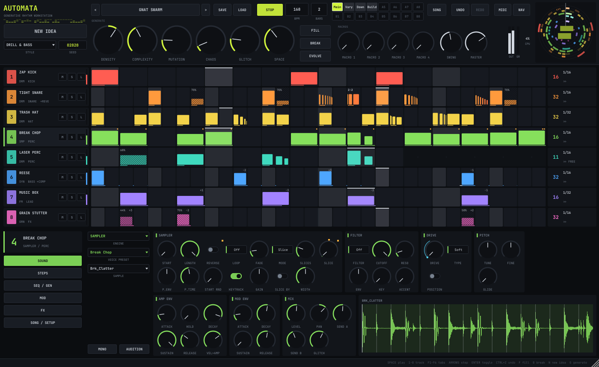
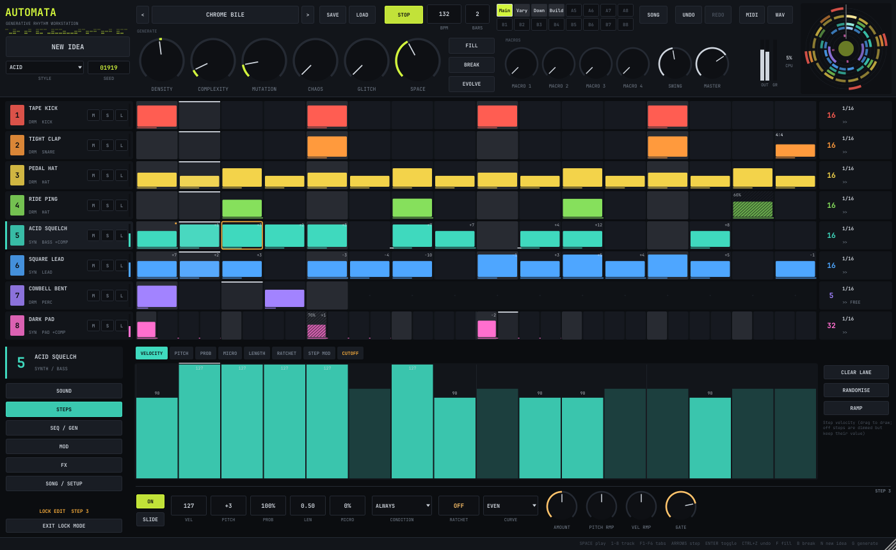

# Automata

A generative rhythm and sound-design instrument for IDM: eight tracks of synth
and sample voices driven by a deep, seeded sequencer, with micro-editing,
parameter locks, heavy modulation and built-in glitch processing.
VST3 instrument + Standalone (AU on macOS). JUCE 9, C++20.

Design principle: **controlled complexity**. Every random decision (probability,
random directions, the Mutation/Density/Complexity/Glitch macros, generators,
New Idea, Evolve) is a pure function of seeds and song position. The same project
plays back identically every time, at any buffer size, after a host loop or a
jump. A happy accident can be kept, locked and refined.

## Download

Ready-made builds are on the [Releases page](https://github.com/chewingbacca/Vst-new-tape-vst/releases/latest):

| | File | Contains |
|---|---|---|
| Windows 10/11 (64-bit) | `Automata-Windows-x64.zip` | VST3, standalone `.exe` |
| macOS 11+ (Apple Silicon and Intel) | `Automata-macOS-Universal.zip` | VST3, Audio Unit, standalone `.app` |
| Linux (x64) | `Automata-Linux-x64.tar.gz` | VST3, standalone |

Each zip has an `INSTALL.txt`. The builds are not code-signed: on macOS run the one-line
`xattr` command from `INSTALL.txt` once after copying, on Windows SmartScreen may ask you to
confirm the standalone app. New releases are built by GitHub Actions (`.github/workflows/build.yml`;
run it with "release" ticked).



The STEPS page in lock mode (an acid line with its cutoff lock lane):



---------------------------------------------------------------------------

## Build

One command from a clean checkout:

```bash
./build.sh                 # Release build: VST3 + Standalone (+ AU on macOS)
./build.sh --test          # ... then unit tests and plugin-level render tests
./build.sh --pluginval     # ... then pluginval at strictness 10
./build.sh --install       # ... and copy the plug-in to your user plug-in folder
```

CMake downloads JUCE 9.0.6 automatically. To use a local JUCE checkout set
`AUTOMATA_JUCE_DIR=/path/to/JUCE`.

Requirements:

| OS | Needs |
|---|---|
| Linux | CMake ≥ 3.22, GCC ≥ 11 or Clang ≥ 14, Ninja (optional), and the JUCE dependencies: `sudo apt install libasound2-dev libx11-dev libxrandr-dev libxinerama-dev libxcursor-dev libxext-dev libxrender-dev libxcomposite-dev libxi-dev libfreetype-dev libfontconfig1-dev libgl1-mesa-dev` (add `xvfb` for headless pluginval) |
| macOS | Xcode command-line tools, CMake ≥ 3.22 (builds VST3, AU and Standalone) |
| Windows | Visual Studio 2022, CMake ≥ 3.22; run the same commands from Git Bash, or `cmake -S . -B build && cmake --build build --config Release` |

Build products are in `build/Automata_artefacts/Release/`.

### Install locations

| Format | Linux | macOS | Windows |
|---|---|---|---|
| VST3 | `~/.vst3/Automata.vst3` | `~/Library/Audio/Plug-Ins/VST3/Automata.vst3` | `C:\Program Files\Common Files\VST3\Automata.vst3` |
| AU | – | `~/Library/Audio/Plug-Ins/Components/Automata.component` | – |
| Standalone | `build/.../Standalone/Automata` | `Automata.app` | `Automata.exe` |

`./build.sh --install` copies the VST3 (and AU) there for you. Rescan plug-ins in your DAW.

---------------------------------------------------------------------------

## Quick start

1. Load Automata on an instrument track and press play in the host (or press
   **Space** in the plug-in to use its own transport).
2. Press **NEW IDEA**. Each press builds a new kit and four patterns (Main, Vary,
   Down, Build) in the chosen **STYLE**. The five digits next to it are the seed:
   type the same seed back to recall that idea exactly.
3. Like a track? Press its **L** button. New Idea and Evolve leave locked tracks alone.
4. Ride the six macros: **Density**, **Complexity** (ratchets and micro-timing),
   **Mutation** (how much each loop differs from the written pattern), **Chaos**,
   **Glitch**, **Space**. Hold **FILL** or **BREAK** for a bar of chaos that snaps back on the bar line.
5. Or browse the 40 factory kits with the **<** **>** buttons around the preset name.

---------------------------------------------------------------------------

## The screen

```
┌ identity / NEW IDEA / style / seed │ presets  save load │ play  bpm  bars │ patterns A1..B8 │ song undo redo │ MIDI WAV ┐
│                                    │ DENSITY COMPLEXITY MUTATION CHAOS GLITCH SPACE │ FILL BREAK EVOLVE │ macros swing master │ meters  visualizer
├ track header (name, engine, M S L) │ steps of all eight tracks ............................................. │ length / speed / dir
├ selected track │ SOUND | STEPS | SEQ/GEN | MOD | FX | SONG/SETUP detail pages
└ status line: hover help for whatever is under the mouse
```

The visualizer draws each track's loop as a ring that turns with its playhead;
polymeters show up as rings turning at different rates, and glitches break the centre.

### Editing steps (the grid)

| Gesture | Does |
|---|---|
| Click / drag | paint steps on or off along the row |
| **Shift**-drag | draw velocity |
| **Ctrl/Cmd**-drag | draw probability (5 % steps) |
| **Alt**-drag | draw ratchet count (1–8) |
| Wheel | pitch (Shift: velocity, Alt: ratchets) |
| **Right-click** | select the step for parameter locks (Shift-right-click extends the range) |
| Double-click | step menu: condition, ratchet, curve, slide, clear locks |
| Drag the length number up/down | track length 1–64 |
| Right-click the track header | copy/paste/clear, shift, double, copy/paste sound |
| Drop an audio file on a track | load it into a Sampler on that track |

Cell drawing: bar height = velocity; split bars = ratchets (spaced by their
curve); hatching = probability below 100 %; the thin line under a step = its gate
length; orange dots = parameter locks; text = condition, probability and pitch.

### Parameter locks

Right-click a step (or a range), then turn **any** knob in any page: the value is
stored for those steps only (the knob turns orange). Locked parameters jump at
the step and return to the base value at the next step. Up to 12 parameters per
track per pattern can be locked; each gets a lane in the **STEPS** page where you
can draw the lock values. Effect parameters can be locked too, which is how
glitch effects are triggered per step (e.g. lock Stutter **On** on one step).
**Esc** leaves lock mode.

### Ratchets and rolls

Each step can repeat 1–16 times. In the **STEPS** inspector: **CURVE** (even,
accelerating, decelerating, bouncing ball), **AMOUNT** (how strongly the curve
bends), **PITCH RMP** (±24 semitones across the roll), **VEL RMP** (fade in/out),
**GATE** (length of each hit). Rolls are sample-accurate and click-free.

### Conditions

`A:B` plays on pass A of every B loops; `FILL` only while Fill is held, `!FILL`
only when it isn't; `PRE` only if the previous step on this track played;
`1ST` only on the first pass. Probability rolls are seeded by song position, so a
50 % step does the same thing every time you play that bar.

### SEQ / GEN page

Per track: length, **speed** (1/2 to 1/64 including dotted, triplets and 5:4, 7:4,
9:8 tuplets), **direction** (forward, reverse, ping-pong, random, drunk), own
swing (24 %–80 %, or follow the global swing), groove template and amount,
**free run** (never resets: true polymeter), scale quantise, role, base note,
pattern seed.

Generators: **Euclid**, **Cellular** automaton (rule, seed density, generations),
**Density** (metric weight, syncopation, clustering, ratchets), **Markov**
(re-walks the existing pattern), **Mutate** (amount × rhythm/pitch/detail).
Every generator has a seed and a **LOCK SEED** switch; **RE-ROLL** picks a new
seed unless it is locked; **LIVE** regenerates while you turn the knobs. Every
generation is one undo step (**Ctrl+Z**).

### SOUND page

Six engines, one per track:

| Engine | Highlights |
|---|---|
| Drum | Kick, Snare, Hat, Clap, Tom, Metal circuit models; ranges well past realistic |
| FM | 4 operators, 8 algorithms, feedback, per-operator envelopes, pitch envelope |
| Sampler | start/length, reverse, loop (forward/ping-pong), gate mode, **slice** mode (grid or transients) for chopping breaks with slice locks |
| Granular | position, size, density, spray, pitch scatter (free/octaves/fifths), scan, reverse probability, window shape |
| Resonator | string, tube (waveguides), bar, bell, membrane, glass (modal); impulse, noise, mallet and bow exciters |
| Synth | analog-style polyBLEP oscillators or five wavetable sets, sync, FM, unison, sub, noise, drift |

Every track also has an amp envelope, a mod envelope, a multimode filter (LP/BP/HP,
notch, saturating ladder), drive (pre or post filter), pitch, glide, accent, level,
pan and two sends. **VOICE PRESET** offers 160 factory voices.

### MOD page

Two LFOs per track (sync or free, sine, triangle, saw, ramp, square, S&H, smooth
random, drawable), a step-modulation lane (in STEPS), mod and amp envelopes,
velocity, note and per-note random. Global: four macros, a chaos source
(Lorenz or logistic map), and an envelope follower on the sidechain input.

**Drag a source chip onto any control** to route it. Modulated controls show their
range as a blue arc and the live value as a dot. Amounts are edited in the matrix
(64 routings); right-click a control to remove its modulation.

### FX page

Two inserts per track, two send buses with two slots each, and four master slots
followed by a soft limiter. Effects: Stutter (buffer repeat with pitch ramp and
shrinking repeats), Reverse, Tape Stop, Crush (bits, rate, jitter), Distort
(seven shapers, 2× oversampled), Comb, Resonator bank (chords), Freq Shift,
Ring Mod, Spectral (FFT freeze / blur / shift), Grain Delay, Delay (synced,
modulated, ping-pong), Plate, Cloud (huge diffuse reverb with freeze and
shimmer), Compressor (sidechain from any track or the external input) and Filter.

Each track also has a built-in glitcher driven by the **Glitch** macro: repeats,
gates, reverses, crushes and stops, decided per step from the seed.

### SONG / SETUP page

Pattern chain with repeats and song mode; key and scale (20 built-in scales, or
load any **Scala .scl** file for microtonal tunings: step pitches then become
scale degrees); MIDI routing.

---------------------------------------------------------------------------

## Patterns, performance and MIDI

* 16 patterns (A1–B8). Click to switch at the next bar (**Shift**-click: now).
* MIDI notes on the **pattern channel** (default 16) select patterns: C1 = A1 … D#2 = B8;
  C3 holds Fill, D3 holds Break.
* MIDI channels 1–8 play tracks 1–8 from your keyboard (60 = the track's base note).
* Every track can send its notes to the plug-in's **MIDI output** (SONG/SETUP page),
  so the sequencer can drive other instruments.
* Outputs: the main stereo mix plus one stereo bus per track (enable them in the
  host). A track set to **ONLY** leaves the main mix and plays only on its bus.
* Sidechain input: feeds the envelope follower and any compressor keyed to "Ext In".
* Host automation: the six macros, four mod macros, master, swing, fill, break,
  evolve and level/pan/mute of every track.

## Export

Drag **MIDI** (top bar) into the DAW: the edited pattern as a MIDI file (one
track per Automata track, with the current macros applied). Drag **WAV**: the
pattern rendered to audio with tails; **Shift**-drag renders only the selected track.

## Keyboard

| Key | | Key | |
|---|---|---|---|
| Space | play / stop | 1–8, ↑ ↓ | select track |
| F1–F6 | detail pages | ← → (Shift) | select step (extend) |
| Enter | toggle step | Delete | clear step |
| + / − | velocity | , / . | pitch |
| R | cycle ratchets | M / S / L | mute / solo / lock track |
| F / B | hold Fill / Break | E | Evolve on/off |
| N | New Idea | G | re-generate track |
| [ / ] | previous / next pattern | A | audition track |
| Ctrl+Z / Ctrl+Shift+Z | undo / redo | Ctrl+C / V | copy / paste track pattern |
| Ctrl+S / Ctrl+O | save / load project | Esc | leave lock mode |

The window is resizable (keeps its proportions).

---------------------------------------------------------------------------

## Factory content

* **40 kits** (8 per style): Broken Beat, Drill & Bass, Ambient Melodic, Clicks &
  Cuts, Acid. Each kit has four patterns and a song chain.
* **160 voice presets** in 14 categories (kicks, snares, hats, percussion, toms
  and metal, FM bells and percussion, FM and synth basses, acid, leads, pads,
  plucks and mallets, sampler, granular, FX).
* **20 factory samples**, all synthesised by Automata itself when first needed
  (six original breakbeats rendered through the drum engine, hits, tape hiss,
  vinyl, radio static, formant vowels, pads, bells and glass tones). Nothing is
  sampled from anywhere else.

Projects (state, patterns, seeds, locks, loaded samples) are saved with the DAW
session; user samples are embedded (FLAC) so a session moves between machines.

---------------------------------------------------------------------------

## Verification

Automata is tested by measuring, not listening:

* `build/tests/automata_tests`: unit tests for sequencer timing (sample-exact onsets
  at 44.1/48/96 kHz, ratchets, micro-timing, swing, polymeter, host loops, tempo
  changes, block-size independence), generators, scales, serialisation, factory
  content, every engine and effect (fuzzing, NaN, denormals, pitch and timing
  accuracy, transparency, RT60 …).
* `build/tools/automata_render_tests`: every kit and voice preset through the real
  `AudioProcessor` with a simulated host: NaN, clipping, DC, clicks, silence,
  bit-identical output with random buffer sizes and after a state round-trip.
* `build/tools/automata_render`: render any project, preset or idea to WAV.
* `build/tools/automata_snapshot`: render the editor to PNG headlessly.
* pluginval at strictness level 10 (`./build.sh --pluginval`).

See `DESIGN.md` for the architecture and `NOTES.md` for decisions and status.

## Licences and credits

* Automata source: written for this project.
* JUCE 9 (AGPLv3 or commercial JUCE licence): you must comply with one of them when distributing binaries.
* JetBrains Mono font (SIL Open Font License 1.1, `assets/fonts/OFL.txt`).
* Half-band oversampling filter coefficients from Laurent de Soras' HIIR (WTFPL).
* The plate reverb follows the topology published by Jon Dattorro (1997); the
  hash function is Chris Wellons' "lowbias32" (public domain).
