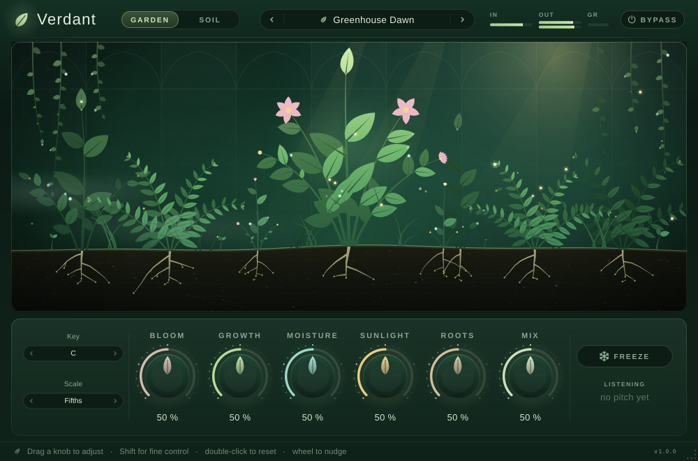
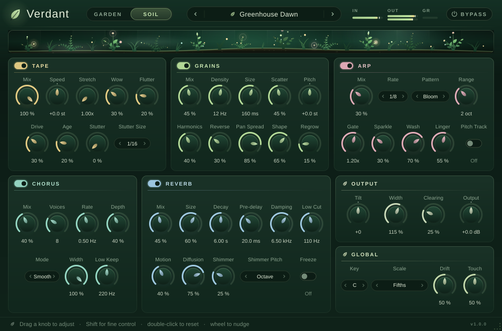

# Verdant

A VST3 audio effect that turns any input — a dry synth, a voice, a single guitar note — into a
lush, botanical, textured soundscape. A greenhouse at dawn: things growing, shimmering, breathing.

```
in ─┬──────────────────────────── dry (time-aligned) ─────────────────────────────┐
    └─ Tape ─┬────────────────┬─► Chorus ─┬──────────────► tone ─► width ─► mix ──┴─► limiter ─► out
             ├─► Grain cloud ─┘           └─► Reverb ────┘
             └─► Arp ──(direct)──► bus,  ──(wash)──► reverb
```



All DSP is original and lives in a JUCE-free C++20 library (`src/dsp`), wrapped by a JUCE 9 plugin
(`src/plugin`) with a fully custom-drawn, resizable editor.

## Build

One command from a clean checkout (downloads JUCE 9.0.5 on first configure):

```bash
./scripts/build.sh
```

or, equivalently, plain CMake:

```bash
cmake -B build -DCMAKE_BUILD_TYPE=Release
cmake --build build --parallel
```

Requirements: CMake >= 3.22, a C++20 compiler (GCC 11+, Clang 14+, Xcode 14+, MSVC 2022), git.

- **Linux** needs the usual JUCE packages: `./scripts/install-linux-deps.sh` (Debian/Ubuntu).
- **macOS** additionally builds an Audio Unit (`Verdant.component`).
- **Windows**: run the two CMake commands from a "x64 Native Tools" prompt.
- Offline / faster configure: `JUCE_PATH=/path/to/JUCE ./scripts/build.sh` uses a local JUCE checkout.

Outputs:

| Target | Path |
|---|---|
| VST3 | `build/Verdant_artefacts/Release/VST3/Verdant.vst3` |
| Standalone | `build/Verdant_artefacts/Release/Standalone/Verdant` |
| AU (macOS) | `build/Verdant_artefacts/Release/AU/Verdant.component` |
| Offline renderer | `build/tests/verdant_render` |
| Unit tests | `build/tests/verdant_tests` |

## Install

`./scripts/install.sh` copies the built plugin to the per-user plug-in folder, or configure with
`VERDANT_INSTALL=1 ./scripts/build.sh` to copy on every build. Manual locations:

| OS | VST3 | AU |
|---|---|---|
| Linux | `~/.vst3/Verdant.vst3` | — |
| macOS | `~/Library/Audio/Plug-Ins/VST3/Verdant.vst3` | `~/Library/Audio/Plug-Ins/Components/Verdant.component` |
| Windows | `C:\Program Files\Common Files\VST3\Verdant.vst3` | — |

Rescan plug-ins in your DAW afterwards. Verdant reports about 5 ms of latency (tape alignment +
limiter look-ahead), supports stereo, mono-to-stereo and mono layouts, and any sample rate from
44.1 to 192 kHz. User presets are stored in `~/.config/Verdant/Presets` (Linux),
`~/Library/Verdant/Presets` (macOS) or `%APPDATA%\Verdant\Presets` (Windows).

## Using it

The **Garden** page has the six macros, Key / Scale, Freeze and the living plant. The **Soil**
page has every module parameter. The preset browser is in the header; the status line at the
bottom explains whatever control is under the mouse. Double-click a knob to reset it, double-click
its value to type one ("3.2k", "-7", "inf"), hold Shift for fine adjustment, use the mouse
wheel for small steps. The window resizes from the corner (75 % to 170 %).



### Macros

Macros never move other knobs; they scale and offset the module settings underneath
(50 % = the preset exactly as designed).

| Macro | What it does |
|---|---|
| **Bloom** | Overall intensity: grain level and density, arp level, chorus amount, tape wobble and drive, stutter chance, shimmer, drift depth. |
| **Growth** | Speed of evolution: drift LFO rates (x0.2 to x5), chorus and reverb motion rates, wow rate, grain flux. |
| **Moisture** | Wetness: reverb level, decay (x0.4 to x2.5) and size, and how much of the arp dissolves into the reverb. |
| **Sunlight** | Brightness: tilt EQ (±4.5 dB), reverb damping, shimmer, arp sparkle, upward grain harmonics; less tape age. |
| **Roots** | Low-end warmth: low shelf (±8 dB), reverb low cut, tape body and drive, downward-octave grains. |
| **Mix** | Global dry / wet (equal power, trimmed in the middle so the level stays steady). |

### Global

| Parameter | Range | Notes |
|---|---|---|
| Key | C … B | Root of the scale; used when Pitch Track is on. |
| Scale | Major, Minor, Dorian, Lydian, Mixolydian, Major/Minor Pentatonic, Whole Tone, Major/Minor Triad, Major 7, Minor 7, Sus 2/4, Fifths, Octaves | The notes the arp draws from. |
| Drift | 0–100 % | Depth of the four slow random modulators (tape wow, grain density/scatter/size, chorus rate/depth, reverb motion, tilt). |
| Touch | 0–100 % | How much your playing dynamics move the sound (grain density, shimmer). |

### Tape

Granular varispeed, wow/flutter, saturation and stutter. With everything neutral it is perfectly
transparent.

| Parameter | Range | Notes |
|---|---|---|
| Tape (on/off), Tape Mix | 0–100 % | Blend between clean and tape path. |
| Speed | ±12 st | Varispeed pitch. Granular with waveform alignment: stays in time and stays clean. |
| Stretch | 1x–8x | Time-stretch: the tape plays slower than real time and snaps back to "now" every bar. |
| Wow / Flutter | 0–100 % | Slow drift (up to ±12 cents) / fast shiver (up to ±6 cents). |
| Drive | 0–100 % | Soft, anti-aliased tape saturation with a little even-harmonic asymmetry. |
| Age | 0–100 % | Worn tape: high-frequency loss (21 kHz down to 3 kHz), head bump, occasional dropouts. |
| Stutter, Stutter Size | 0–100 %; 1/4 … 1/32, Random | Chance of a tempo-synced slice repeating 2–8 times, sometimes ramping in pitch. |

### Grain cloud

| Parameter | Range | Notes |
|---|---|---|
| Grains (on/off), Grain Mix | 0–100 % | Level of the cloud. |
| Density | 0.5–80 grains/s | Sparse dew drops to thick foliage; loudness is normalised across the range. |
| Size | 10–800 ms | Grain length. |
| Scatter | 0–100 % | How far back in time (up to 3 s) grains are picked from. |
| Pitch | ±24 st | Base transposition. |
| Harmonics | 0–100 % | Chance of a grain jumping to an octave or fifth (always consonant). Sunlight biases up, Roots down. |
| Reverse | 0–100 % | Probability a grain plays backwards. |
| Pan Spread | 0–100 % | Random stereo placement. |
| Shape | 0–100 % | Plucked droplets … soft swells. |
| Regrow | 0–100 % | Feeds the cloud back into its own buffer: cascading layers. |

### Arp / shimmer

Re-plays what it just heard as tempo-synced pitched notes. It records only while you play, so
after you stop it keeps arpeggiating your last sound.

| Parameter | Range | Notes |
|---|---|---|
| Arp (on/off), Arp Mix | 0–100 % | Level of the arp layer. |
| Rate | 1/2 … 1/32 incl. triplets | Step length, locked to the host tempo and position (120 BPM free-running without a host). |
| Pattern | Up, Down, Up-Down, Random, Bloom | Bloom opens a chord outward with long overlapping notes, then breathes. |
| Range | 1–4 octaves | Span of the pattern (3 and 4 also reach below the played note). |
| Gate | 0.1x–4x | Note length relative to the step. |
| Sparkle | 0–100 % | Octave-up doubling of each note. |
| Wash | 0–100 % | 0 = arp heard directly; 100 = arp only feeds the reverb. |
| Linger | 0–100 % | How long the arp carries on after the input stops (100 % = forever). |
| Pitch Track | on/off | **Off:** Scale is applied as intervals above whatever you play (the default scale, Fifths, is safe in any key). **On:** the input note is detected and arp notes land exactly on Key / Scale — set Key to your song. Works on monophonic material; on chords it falls back to interval mode. |

### Chorus

| Parameter | Range | Notes |
|---|---|---|
| Chorus (on/off), Chorus Mix | 0–100 % | |
| Voices | 2–24 | Loudness stays constant across voice counts. |
| Rate, Depth | 0.05–8 Hz, 0–100 % | Depth is defined as pitch deviation (max ±21 cents), so it feels the same at any rate. |
| Mode | Smooth / Glassy | Smooth: classic wide ensemble. Glassy: short taps with a touch of resonance and a brighter, thinner sheen. Switching is a click-free morph. |
| Width | 0–100 % | Stereo spread of the voices. |
| Low Keep | 40–1000 Hz | Everything below stays unchorused, mono-solid and in phase (24 dB/oct). |

### Reverb

A 16-line modulated feedback delay network.

| Parameter | Range | Notes |
|---|---|---|
| Reverb (on/off), Reverb Mix | 0–100 % | |
| Size | 0–100 % | Small room to enormous. Moving it glides the pitch of the tail. |
| Decay | 0.3–60 s, then **Infinite** | Fully clockwise never decays (with Shimmer at 0; with shimmer the tail slowly climbs out of hearing). |
| Pre-delay | 0–250 ms | |
| Damping | 0.5–20 kHz | High-frequency damping inside the tail. |
| Low Cut | 20–1000 Hz | Low cut on the reverb plus bass absorption in the tail. |
| Motion | 0–100 % | Delay-line modulation depth (up to about ±14 cents of chorusing). |
| Diffusion | 0–100 % | Echo-like build-up … instant smooth wash. |
| Shimmer, Shimmer Pitch | 0–100 %; Octave, Fifth, Octave + Fifth, Two Octaves, Octave Down | Pitch shifting inside the feedback loop: the tail climbs (or sinks) as it decays. |
| Freeze | on/off | Holds the current tail indefinitely and stops listening to the input. |

### Output

| Parameter | Range | Notes |
|---|---|---|
| Tilt | −100…+100 | Tilt EQ on the wet signal (±6 dB). |
| Width | 0–200 % | Stereo width of the wet signal; extra width only applies above 180 Hz. |
| Clearing | 0–100 % | Ducks the ambience while you play so it blooms in the gaps. The reverb still hears everything. |
| Output | −24…+12 dB | Wet level before the limiter. |
| Bypass | on/off | Click-free, latency-compensated true bypass; tails ring out. |

A look-ahead limiter (2 ms, −0.3 dBFS ceiling) is always last in the chain: while the plugin is
active nothing leaves it above the ceiling, whatever the settings or the input. (Bypass passes
the input through untouched, including anything hotter than that.)

## Factory presets

| Category | Presets |
|---|---|
| Lush | **Greenhouse Dawn** (default), Fern Canopy, Orchid Shimmer, Rain On Glass, Wisteria, Sunroom Choir, Lydian Canopy* |
| Subtle | Morning Dew, Potting Shed Tape, Glasshouse Air, Moss, Leaf Shadow, Bare Soil |
| Motion | Tendrils, Pollinator, Time-Lapse Bloom, Photosynthesis, Wind In The Reeds, Pentatonic Rain* |
| Deep | Root Cellar, Mycelium, Cathedral Of Vines, Night Garden |
| Wild | Overgrowth, Frozen Orchard, Spore Storm, Tape Compost, Bioluminescence |

\* uses Pitch Track: set **Key** to your song. All other presets are key-agnostic.

## Testing

```bash
./scripts/test.sh                 # unit tests + full render suite (+ pluginval if found)
QUICK=1 ./scripts/test.sh         # shorter render matrix
PLUGINVAL=/path/to/pluginval ./scripts/test.sh
```

- **Unit tests** (`build/tests/verdant_tests`, also `ctest --test-dir build`): 41 tests covering
  filters, saturation, limiter proof, tape transparency and transposition, grain loudness
  normalisation, pitch tracker accuracy, arp scale/key correctness, chorus reconstruction and
  click-freeness, reverb decay accuracy / infinite / freeze / run-away, and engine-level latency,
  bypass, block-size invariance, dry/wet time alignment, ducking, reset determinism,
  silence-in/silence-out, NaN recovery and click-free switching, plus regression tests for
  every defect found by an independent code review (long-run varispeed, decay jumps, stale
  reverb input, saturated grain pool, slow tempo, reset exactness).
- **Render suite** (`build/tests/verdant_render --suite --out DIR`): 320 offline renders — every
  preset × impulse / sine sweep / noise burst / synth phrase / plucked string / sung vowel, each
  module solo, silence, hostile input (+12 dBFS squares, DC), 44.1–192 kHz, block sizes 1–4096,
  random block sizes with brutal random automation, preset cycling under audio, and extreme
  corners (everything maxed, infinite + full shimmer, freeze for a minute). Each render is checked
  for non-finite samples, peaks above the limiter ceiling, DC offset, unexpected silence, runaway
  or stuck tails. WAVs and `report.jsonl` land in the output directory.
- **Analysis** (`tools/analyze.py`, needs numpy/scipy/matplotlib): `spec`, `sheet`, `stats`,
  `report` — spectrograms and measurements of rendered files.
- **Single renders**: `build/tests/verdant_render --preset "Orchid Shimmer" --signal pluck
  --set revDecay=20 --at 3:revFreeze=1 --out renders` (see `--help`, `--list-presets`,
  `--list-params`).
- **pluginval**: `pluginval --strictness-level 10 build/Verdant_artefacts/Release/VST3/Verdant.vst3`.
- **UI snapshots**: `build/tools/ui_snapshot/verdant_ui_snapshot` renders the editor to PNG
  (run under `xvfb-run -a` on a headless Linux box).

## Design notes

See [NOTES.md](NOTES.md) for the engineering log: module internals, stability arguments, the
macro map, measured numbers and what is next.

Real-time safety: the audio thread never allocates, locks or does I/O. All buffers are sized in
`prepare()`; parameters are read from atomics and smoothed on a fixed 32-sample internal control
grid, so behaviour is identical at any host buffer size.

## Licensing

No licence has been chosen for this repository's own code yet. Note that it links JUCE, which is
dual-licensed (AGPLv3 or a commercial JUCE licence): distributing binaries means either releasing
under AGPLv3-compatible terms or holding a JUCE licence. "VST" is a trademark of Steinberg Media
Technologies GmbH.

## Credits and references

All code in this repository is original. Ideas and published techniques it builds on:

- JUCE 9 (framework; AGPLv3 / commercial) — https://juce.com
- J.-M. Jot, A. Chaigne, "Digital Delay Networks for Designing Artificial Reverberators", AES 1991.
- J. Dattorro, "Effect Design Part 1: Reverberator and Other Filters", JAES 1997.
- G. Luff (Signalsmith Audio), "Let's Write A Reverb", 2021 — multichannel diffusion, Hadamard mixing.
- M. Puckette, *The Theory and Technique of Electronic Music*, §7.9 — delay-line pitch shifter.
- W. Verhelst, M. Roelands, "An overlap-add technique based on waveform similarity (WSOLA)", ICASSP 1993.
- A. de Cheveigné, H. Kawahara, "YIN, a fundamental frequency estimator", JASA 2002.
- J. Parker, V. Zavalishin, E. Le Bivic, "Reducing the aliasing of nonlinear waveshaping using
  continuous-time convolution", DAFx-16 — antiderivative anti-aliasing.
- V. Zavalishin, *The Art of VA Filter Design* — TPT state-variable filter.
- Product references named in the brief (studied from public documentation only; no code or
  presets used): Tape Fiasco (Jonas
  Eriksson), Flex Chorus (Minimal Audio), Supermassive (Valhalla DSP), Blackhole (Eventide).
