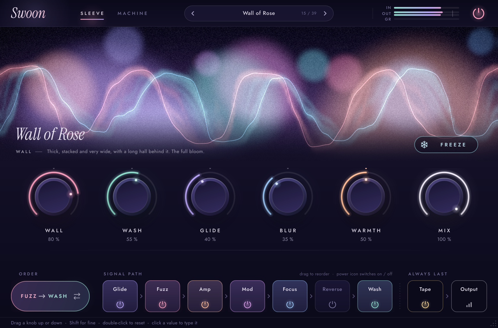
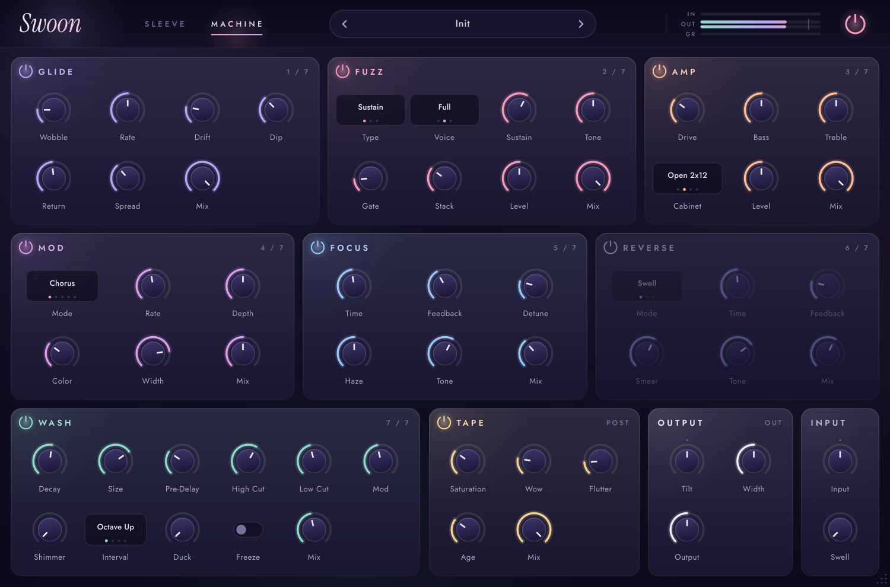

# Swoon

A shoegaze effect in one plugin: a wall of fuzz dissolving into a wash of
reverb, pitch that drifts like a held tremolo arm, and blurred, dreamy edges.
Put it on a plain DI guitar (or a synth, or a vocal) and it supplies the rest.

VST3 and Standalone (plus AU when built on macOS). Built with JUCE 9 and
CMake in C++20. All of the signal processing is original code written for
this project; there are no impulse responses, no third-party DSP libraries
and no code from commercial products.




## Build

One command from a clean checkout:

```sh
./build.sh
```

This configures CMake, fetches JUCE 9.0.6, builds the plugin, the offline
render harness and the unit tests, and runs the unit tests. Results land in
`build/Swoon_artefacts/Release/` (`VST3/Swoon.vst3`, `Standalone/Swoon`, and
`AU/Swoon.component` on macOS).

- `./build.sh --install` also copies the plugin into your user plugin folder.
- `./build.sh --full` also runs the offline verification suite (see
  [Testing](#testing)).
- `SWOON_JUCE_DIR=/path/to/JUCE ./build.sh` builds against a local JUCE
  checkout instead of fetching one.

Without the script:

```sh
cmake -S . -B build -DCMAKE_BUILD_TYPE=Release
cmake --build build --config Release --parallel
ctest --test-dir build -C Release
```

### Requirements

- CMake 3.22 or newer, a C++20 compiler (GCC 11+, Clang 14+, Xcode 14+, MSVC 2022), Git.
- **Linux** (Debian/Ubuntu names):
  `sudo apt install build-essential cmake ninja-build pkg-config libasound2-dev libjack-jackd2-dev libx11-dev libxext-dev libxrandr-dev libxinerama-dev libxcursor-dev libxi-dev libxrender-dev libxcomposite-dev libfreetype-dev libfontconfig1-dev libgl1-mesa-dev`
- **macOS**: Xcode command-line tools. AU is added to the build automatically.
- **Windows**: Visual Studio 2022 with the C++ workload.
- For the analysis tools only: Python 3 with `numpy scipy matplotlib soundfile`.

Only the Linux build has been compiled and tested so far (see
[Status](#status-and-limits)).

### Where the plugin goes

`--install` (or `-DSWOON_COPY_PLUGIN=ON`) copies to the standard user folders:

| OS | VST3 | AU |
|---|---|---|
| Linux | `~/.vst3/Swoon.vst3` | n/a |
| macOS | `~/Library/Audio/Plug-Ins/VST3/Swoon.vst3` | `~/Library/Audio/Plug-Ins/Components/Swoon.component` |
| Windows | `%COMMONPROGRAMFILES%\VST3\Swoon.vst3` (needs an elevated prompt) | n/a |

To install by hand, copy the `Swoon.vst3` bundle from
`build/Swoon_artefacts/Release/VST3/` into that folder and rescan in your DAW.
User presets are saved as `.swoon` files under `~/.config/Swoon/Presets`
(Linux), `~/Library/Application Support/Swoon/Presets` (macOS) or
`%APPDATA%\Swoon\Presets` (Windows).

## Using it

Two pages, switched at the top of the window.

**Sleeve** (front page): six macros, the signal path, and the haze, which
moves with the audio.

| Macro | What it does |
|---|---|
| **Wall** | Fuzz amount and density: fuzz mix, sustain, and how far the two sides are stacked apart. |
| **Wash** | Reverb size and mix: hall mix, decay time and room size together. |
| **Glide** | Pitch drift: scales the wobble, the random drift and the strum dip. |
| **Blur** | Soft focus and modulation: their mixes, detune and haze. |
| **Warmth** | Darker, softer and more saturated above noon; brighter and cleaner below. |
| **Mix** | Dry/wet for the whole plugin (the dry signal is delay-compensated). |

The first five are centred: **50 % means "exactly what the module page
says"**. Turning one down fades that part of the sound out (0 % removes it);
turning it up pushes past the module settings. Factory presets park the
macros where they make sense for that sound, so a clean preset has Wall at
0 %, and raising it brings the fuzz in.

The **signal path** strip shows the seven reorderable modules. Drag to
reorder, click a module's power icon to switch it on or off, double-click a
module to jump to its panel on the Machine page. The **Fuzz → Wash** button
flips the one routing choice that matters most: fuzz into reverb is clear and
defined; reverb into fuzz is the smeared wall, where every tail is dragged
back up into the distortion. Tape and Output always come last.

**Machine** (second page): every parameter of every module.

Controls: drag up/down, hold Shift for fine adjustment, double-click to reset,
mouse wheel to nudge. Click a value readout (or Ctrl/Cmd-click a knob) to type
a value. The line along the bottom of the window explains whatever is under
the mouse. **Freeze**, on the corner of the haze, holds the current reverb
tail for as long as it is lit. Click the preset name to open the browser
(search, categories, notes, save and delete for your own presets).

### Parameter guide

#### Glide — the held tremolo arm
The whole signal is replayed by a variable-speed read head, the way tape
varispeed or a bent string works, so pitch moves without the graininess of a
pitch shifter.

| Parameter | Range | |
|---|---|---|
| Wobble | 0–60 ct | Depth of the slow up-and-down wobble. |
| Rate | 0.05–8 Hz | Wobble speed (wanders slightly, like a hand). |
| Drift | 0–60 ct | Random, slow pitch wandering. |
| Dip | 0–200 ct | How far the pitch drops on each detected strum. Harder strums dip further. |
| Return | 40–2500 ms | How long the pitch takes to swim back up after a dip. |
| Spread | 0–100 % | Lets left and right drift apart. Low values stay centred; high values sound like two players. |
| Mix | 0–100 % | Below 100 % the drifting copy sits beside the dry signal as a double. |

#### Fuzz
Two cascaded clipping stages, each simulated as a gain stage with a capacitor
and a diode pair in its feedback loop, run 8× oversampled.

| Parameter | Range | |
|---|---|---|
| Type | Sustain / Octave / Velcro | Sustain: thick and singing. Octave: a rectifier in front adds an octave up. Velcro: a starved second stage that spits and cuts notes off. |
| Voice | Flat / Full / Scoop | Mid response of the tone stack: slightly dipped, pushed low mids, or the classic deep scoop. |
| Sustain | 0–100 % | Gain into the clippers (a 40 dB range). There is some fuzz even at zero. |
| Tone | 0–100 % | Dark to bright. |
| Gate | 0–100 % | Closes the input below a threshold so the noise floor isn't amplified. 0 is off. |
| Stack | 0–100 % | Feeds each side a slightly different, drifting delay before the fuzz: two guitars instead of one. |
| Level | −24 to +12 dB | Fuzz output level. |
| Mix | 0–100 % | Fuzz against clean. |

#### Amp
A clean amp and cabinet so a DI signal sounds like a guitar in a room.

| Parameter | Range | |
|---|---|---|
| Drive | 0–100 % | Clean through edge-of-breakup to overdriven. |
| Bass, Treble | 0–100 % | Shelving tone controls (centre is flat). |
| Cabinet | Direct / Open 2x12 / Closed 4x12 / Chime 1x12 | Hand-voiced filter sets, not impulse responses. Direct bypasses the cabinet. |
| Level | −24 to +12 dB | |
| Mix | 0–100 % | |

#### Mod
| Parameter | Range | |
|---|---|---|
| Mode | Chorus / Ensemble / Vibrato / Flanger / Phaser | Ensemble is a three-voice, three-phase string-machine chorus. |
| Rate | 0.02–10 Hz | |
| Depth | 0–100 % | |
| Color | 0–100 % | Feedback (chorus, flanger, phaser) or tone (ensemble, vibrato). |
| Width | 0–100 % | Phase offset between left and right. |
| Mix | 0–100 % | Equal-power; 100 % is fully wet (true vibrato). |

#### Focus — soft focus
Four micro-detuned chorus voices, two long delays in a 250 : 380 ms ratio
feeding each other, and a dense haze over the top.

| Parameter | Range | |
|---|---|---|
| Time | 60–900 ms | Left delay time; the right is 1.52× longer. |
| Sync | Free, 1/16 … 1/2 | Locks the left delay to the host tempo; the right becomes its dotted value (1.5×). |
| Feedback | 0–90 % | |
| Detune | 0–40 ct | Peak detune of the chorus voices. |
| Haze | 0–100 % | Amount and length of the reverb inside the patch. |
| Tone | 0–100 % | Darkens the repeats and the haze. |
| Mix | 0–100 % | |

#### Reverse
| Parameter | Range | |
|---|---|---|
| Mode | Swell / Tape / Both | Swell is the rack-unit "reverse reverb": a run of delay taps that rise in level and then stop, so notes bloom out of nothing. Tape is true reverse delay. Both feeds the reverse delay into the swell. |
| Time | 60–1600 ms | Length of the swell, or of each reversed slice. |
| Sync | Free, 1/16 … 1/2 | Locks Time to the host tempo. |
| Feedback | 0–90 % | Repeats. |
| Smear | 0–100 % | Shape of the rise and amount of diffusion. |
| Tone | 0–100 % | Low-pass on the wet signal. Turn it down for the classic sound. |
| Mix | 0–100 % | At 100 % there is no dry signal at all, which is how the swell was used on the records. |

#### Wash
A sixteen-line feedback delay network with slowly modulated lines.

| Parameter | Range | |
|---|---|---|
| Decay | 0.3–60 s | Mid-band decay time. |
| Size | 0–100 % | Small room to enormous hall. |
| Pre-Delay | 0–250 ms | |
| High Cut | 0.8–18 kHz | Damping: how quickly the top end dies. Warmth moves this too. |
| Low Cut | 20–1000 Hz | Keeps the low end out of the tail. |
| Mod | 0–100 % | Chorusing inside the tail. |
| Shimmer | 0–100 % | Adds a pitch-shifted copy inside the reverb loop, so the tail keeps climbing. It cannot run away. |
| Interval | Octave Up / Fifth Up / Octave Down / Up + Down | |
| Duck | 0–100 % | Lowers the reverb while you play and lets it rise between phrases. |
| Freeze | on/off | Holds the current tail indefinitely and closes the input. |
| Mix | 0–100 % | |

#### Tape
| Parameter | Range | |
|---|---|---|
| Saturation | 0–100 % | |
| Wow | 0–100 % | Slow speed variation. |
| Flutter | 0–100 % | Fast speed variation. |
| Age | 0–100 % | Loses top end, adds head bump and a little level instability. |
| Mix | 0–100 % | |

#### Output and input
| Parameter | Range | |
|---|---|---|
| Tilt | −100 to +100 | Tilts the spectrum around 700 Hz (darker to brighter). |
| Width | 0–200 % | Mono to extra wide. Widening leaves the bass centred. |
| Output | −24 to +12 dB | A soft limiter after this holds the output under −0.2 dBFS whatever you do. |
| Input | −24 to +24 dB | Trim so the fuzz and gate see a sensible level. Not changed by presets. |
| Swell | 0–100 % | Fades each note in, like riding a volume pedal. |
| Bypass | on/off | Click-free and latency-compensated. |

The seven **Position** parameters (Glide, Fuzz, Amp, Mod, Focus, Reverse,
Wash; 1–7) set the module order and can be automated. Equal values fall back
to the default order.

### Factory presets

39 presets in six categories: **Dream Pop** (clean to lightly driven
shimmer), **Glide** (the tremolo-arm sounds), **Wall** (sustaining fuzz and a
lot of air), **Ambient** (long, slow, mostly reverb), **Texture** (reverse,
velcro, vibrato and other strangeness) and **Utility** (starting points and
single-module setups). They are level-matched within each kind of sound.

### Audition clips

`docs/audio/` holds short MP3 renders of a dozen presets (and the dry input,
`00-dry-di.mp3`) made by `python3 tools/make_demos.py`. The source is the test
harness's synthesised strummed-guitar phrase, a plucked-string model rather
than a real instrument, so treat them as a sketch of what each preset does.

### Latency and CPU

Swoon reports a fixed latency of about 5.2 ms (251 samples at 48 kHz) from the
oversampled fuzz, the tape transport and its internal 32-sample block; it does
not change when modules are switched on or off, and the sound does not depend
on the host's buffer size. Glide adds a further, unreported 10–45 ms to the wet
signal while it is on. That delay is the effect itself (the same way a chorus
has one), but it matters if you play through the Standalone build live.

Measured on the development machine (a 2.1 GHz Xeon virtual CPU) at 48 kHz,
the heaviest presets use about 11–14 % of one core and clean presets about
5–6 %, whatever the host's buffer size.

## Testing

```sh
./build.sh --full                       # everything below
build/swoon_tests                       # unit tests
python3 tools/run_suite.py --out out/suite   # render suite, writes out/suite/report.md
python3 tools/click_tests.py            # click tests only
python3 tools/preset_report.py          # loudness / balance table for the presets
```

- **Unit tests** (`Tests/unit_tests.cpp`): parameter table, oversampler
  (pass-band, images, exact latency), the diode solver, pitch shifter, reverb
  stability (maximum decay and shimmer for 20 s, lossless freeze), glide
  accuracy and splicing, and engine invariants: bit-exact bypass, constant
  latency, identical output for any host block size, zero heap allocations
  while processing, random parameter abuse, non-finite input, rapid
  reordering, the limiter ceiling, silence in → silence out.
- **Render suite** (`tools/run_suite.py`): renders an impulse, a sine sweep,
  tone bursts, silence and a synthesised strummed-guitar phrase through every
  module and every preset, and checks for non-finite samples, clipping, DC,
  runaway tails, silence and fuzz aliasing, across 44.1–192 kHz and block
  sizes from 1 to 4096. It writes WAVs, spectrograms and a report.
- **Click tests**: toggles bypass, every module, the module order and every
  mode switch on a steady tone and looks for broadband spikes.
- **pluginval**: `run_suite.py` runs it at strictness 10 when it can find the
  binary (`PLUGINVAL=/path/to/pluginval`, or on `PATH`).

`build/swoon_render` is the harness itself; `Tests/render_main.cpp` lists its
options. `build/swoon_ui_snapshot out.png` renders the editor to a PNG without
a host (wrap it in `xvfb-run -a` on a headless Linux box).

## Status and limits

- Built and tested on Linux x86-64 only. The code is portable JUCE and
  standard C++ and CMake adds AU on macOS, but macOS and Windows builds have
  not been compiled or run.
- Verified by measurement, not by ear: see `NOTES.md` for what the
  measurements cover and what still needs a listening pass.
- The fuzz model is fastest when the compiler vectorises it (GCC and Clang do
  at `-O3`).

## Layout

```
Source/dsp/          the DSP engine: plain C++20, no JUCE dependency
Source/ui/           editor components
Source/Plugin*.cpp   JUCE processor, editor shell, preset manager
Tests/               render harness, unit tests, headless UI snapshot tool
tools/               Python analysis: suite runner, click tests, preset report
Assets/              embedded fonts
NOTES.md             design decisions, measurements, what is next
```

## Credits and licences

- [JUCE](https://juce.com) 9 (AGPLv3 or commercial licence). Distributing
  binaries built from this repository is subject to JUCE's terms.
- Fonts: Instrument Serif and Jost, both under the SIL Open Font License 1.1
  (`docs/licenses/`).
- The DSP draws on published, general knowledge of how these effects work
  (feedback delay networks, diode-clipper circuit equations, delay-line pitch
  shifting, antiderivative anti-aliasing, half-band oversampling). The
  inspirations are named in `NOTES.md`; nothing was copied from any product.
